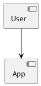

# Create Agents


If there isn’t an agent that helps with your needs, create one! Creating an agent is simple, and once it works and helps you, share it so your team and the Tero community can benefit too.

While you create or edit an agent, every change is saved automatically and you can try your changes right away in the chat on the right.

## Clone

One of the easiest ways to create an agent is to clone an existing one. This lets you adapt an agent to your context (project, preferences, way of working), or create similar agents reusing existing ones as templates.

You can clone an agent from the agent detail dialog in [Explore agents](./discover.md) or from any chat with that agent.

## Basic Info

When you create an agent, choose a good icon, name, and description. This helps quickly identify it among other agents.

Names and descriptions are purposely short in Tero to support quick scanning and selection. Think of the user and be succinct so the agent’s purpose is clear.

::: tip Description for subagents
If this agent will be used as a [subagent](./tools/subagent.md), the parent uses the description to decide when to delegate. Keep it specific about what the agent is for.
:::

::: tip Auto-generate
Tero can auto-generate the name, description, and system prompt from the other fields. If you’ve set some fields, use the magic wand to generate or refine the rest. It’s handy for starting values or quick adjustments.
:::

## Model

Tero supports a growing variety of LLM models you can use as the basis for your agent. The model is like the agent’s brain: it analyzes each user request, plans how to answer using the configured tools, and either generates an answer or invokes tools as needed.

Available models in your Tero instance depend on how it’s configured. Currently Tero supports models from OpenAI (GPT), Azure OpenAI (GPT), AWS Bedrock (Claude), and Google (Gemini). The community continues to expand this list.

::: tip Cheaper & faster first
When creating an agent, start with cheaper and faster models. They’re easier to use and help you, and others, avoid unnecessary budget spend (in general more powerful = more expensive).
:::

::: tip Experiment
Different models excel at different tasks (e.g., Claude often shines for code; GPT can be great for brainstorming or writing). Experiment, and don’t assume a new version of a model behaves like the previous one.
:::

Depending on the model type, you may also set Temperature or Reasoning level.

### Temperature

Temperature controls how much the agent’s answers vary. For more creative outputs (e.g., brainstorming), choose Creative. For more consistent, precise answers with less variation, choose Precise. Use Neutral for a balanced behavior.

### Reasoning Level

Reasoning level defines how much the agent analyzes before answering. More reasoning usually means better results but slower responses. Use High for complex tasks, Low for simple tasks, and Medium for relatively simple ones.

## Instructions

The instructions (aka system prompt) define how your agent responds to user requests. A good system prompt usually includes a role the agent should assume, the main tasks it solves, formatting expectations for answers, and optionally examples of inputs and outputs.

::: tip Short and simple
Prefer short, simple prompts. The bigger the prompt, the harder it is to follow by the agent and for you to maintain.
:::

::: tip Agent to tune system prompt
Use an agent to help you improve your system prompt. You can use the [Agents from Scratch](https://github.com/abstracta/tero-agents/blob/main/en/agents-from-scratch/agent.md) agent if you need help to start from scratch.
:::

::: tip Divide & Conquer
Avoid “do everything” agents. Focus each agent on a specific task and create multiple agents for different needs. It keeps instructions short, answers better, reduces budget by limiting context, and makes it easier for users to discover the right agent.

To combine specialists into one workflow, switch the orchestrator to [Advanced](#agent-mode) mode and add the [Subagent](./tools/subagent.md) tool.
:::

::: tip Optimize
Start simple, then optimize. Review the [Thought Process](./chat.md#thought-process) to see how the agent solves requests and add step-by-step guidance to the prompt for recurring tasks. This makes answers faster, more predictable, and reduces budget usage. With detailed instructions, you can often use cheaper & faster models too.
:::

::: tip Markdown
Ask the agent to format answers in Markdown. You’ll get cleaner results (headings, lists, tables, code blocks, etc.).
:::

::: tip PlantUML
If you need UML or general diagrams, ask the agent to use [PlantUML](https://plantuml.com/).

When doing so, instruct the agent not to wrap diagrams in code blocks so they render properly. Add something like the following to the agent's system prompt:

```
When generating PlantUML diagrams, do not wrap them in code blocks. Output the raw diagram text starting directly with @startuml.
```

Example — this generates only the text of the diagram:

````

````

And this renders a diagram image:

````
@startuml
[User] --> [App]
@enduml
````
:::

::: tip ECharts
You can also ask the agent to present information using charts with [ECharts](https://echarts.apache.org/en/index.html).
:::

## Conversation Starters

When you create an agent, consider adding [Conversation starters](./chat.md#conversation-starters). They help new users understand what the agent can do and get going quickly. Like any other prompt, they can use [variables](./chat.md#variables) to ask for the details you need.

## Tools

Tools extend what your agents can do. Below is the list of currently supported tools. Expect it to grow as the community contributes new ones.

:::: tip Keep it lean
Enable only the tools your agent truly needs. Fewer tools makes the agent faster, cheaper, and more predictable.
::::

@include: ./tools/index.md

## Advanced Settings

In the agent editor, **Advanced settings** lets you configure agent mode, the thought process steps limit, and protected configuration.

### Agent mode

Every agent runs in one of two modes: **Basic** or **Advanced**. Basic is the default and works well for most agents.

**Basic** responds quickly and works well for chat, drafting, Q&A, and tasks that need a few tool calls per request.

**Advanced** is for complex, multi-step work. It can offload large context to files attached to the chat, summarize long conversations to stay within model limits, and keep better track of subtasks across many steps. It is a better fit when the agent relies heavily on tools or when a single request spans a long-running workflow. Advanced mode is also required to configure [subagents](./tools/subagent.md) — other Tero agents the orchestrator can delegate work to. Advanced mode typically takes longer and uses more budget than Basic.

#### When to use which

Use **Basic** if:

- The agent mainly answers questions, drafts text, or brainstorms ideas.
- Each user request usually needs zero to a few tool calls.
- You want the fastest responses and lowest cost.
- You are creating a new agent — start here.

Use **Advanced** if:

- A request often requires many tool calls in sequence (e.g., search, read, compare, update, verify).
- Users attach large documents and the agent must refer back to them across multiple turns.
- Chats run long and the agent loses earlier context or truncates attachments in Basic mode.
- You want the agent to delegate parts of a request to other specialized agents.

When in doubt, keep **Basic**. Switch to **Advanced** only when you see a clear need — for example, lost file context or workflows that stall in Basic mode.

::: tip Start with Basic
Create and tune new agents in Basic mode first. Optimize the system prompt, tools, and model before switching to Advanced. Advanced mode solves different problems — it is not a substitute for clear instructions.
:::

::: tip Files in Advanced mode
In Advanced mode, text attachments are kept in a per-chat workspace the agent can read across turns, instead of repeating the full content every time.
:::

::: warning Switching to Basic
Switching back to Basic removes any configured subagents. The agent will no longer be able to delegate work.
:::

### Thought process steps limit

This setting caps how many steps the agent can take while answering a single request — each model turn or tool call counts toward the limit. It prevents runaway loops and unnecessary budget spend.

The default is **20** steps. You can raise it to **40**, **60**, **80**, or **100** if legitimate workflows need more room.

::: warning Budget and latency
Higher limits increase response time and budget usage. Before raising the limit, review the [Thought Process](./chat.md#thought-process) for failed requests and tighten the system prompt or reduce tools so the agent needs fewer steps.
:::

### Protected configuration

**Protected configuration** is available only to **global owners** of the Tero instance. When enabled, other users cannot view, clone, or modify the agent’s configuration — including its system prompt, model, tools, and advanced settings. They can still chat with the agent normally.

Use this when you publish an agent widely but want to keep its setup private — for example, agents with sensitive instructions, proprietary workflows, or carefully tuned behavior you do not want copied or edited.

::: warning Use sparingly
Avoid unless truly necessary. Protected agents can't be learned from, cloned, or improved by others — working against Tero's spirit of collaboration and sharing.
:::

## Tests


Tero focuses on software quality, and quality requires tests. Add tests to ensure your agents behave as intended.

Tests let creators and editors experiment safely. Define a test suite for your agent by specifying user inputs and example expected outputs. Then you can change models, prompts, tools, etc., and verify, by running the test suite, that your core use cases still work.

## Publish

When your agent starts being useful to you, share it with your team so others can benefit too!

You can share it with any private team (only your teammates can use it), or with the Global team (all users in your Tero instance can discover and use it).

When you share an agent with a team, the team leaders can edit the agent if they need to improve it. You’ll still be able to edit it, and you’ll remain listed as the author.

## Export & Import

You can move agents (or their updates) between Tero environments by exporting and importing them.

Furthermore, you can import any agents contributed by the community from the [public repository of agents](https://github.com/abstracta/tero-agents).

## Persistent memory

Persistent memory lets an **Advanced** agent remember useful information across chats. Each memory belongs to a specific user and agent: it is shared across that user's chats with the same agent and isolated from other users and agents. Basic agents do not use persistent memory.

For new agents, persistent memory is off by default. To enable it, switch the agent to **Advanced** mode and turn on **Persistent memory** in its advanced settings.

When persistent memory is off, the agent cannot read or update its memory. Turning it back on restores access to the existing memory. Switching the agent temporarily to Basic mode also leaves its memory intact, and deleting a chat does not delete persistent memory.

Manage remembered information by asking the agent to remember or forget it. Do not store passwords, access tokens, or other secrets in agent memory.

Be part of the Tero community: contribute your agents so everyone benefits! Export your agent and submit a Pull Request to the repository.
